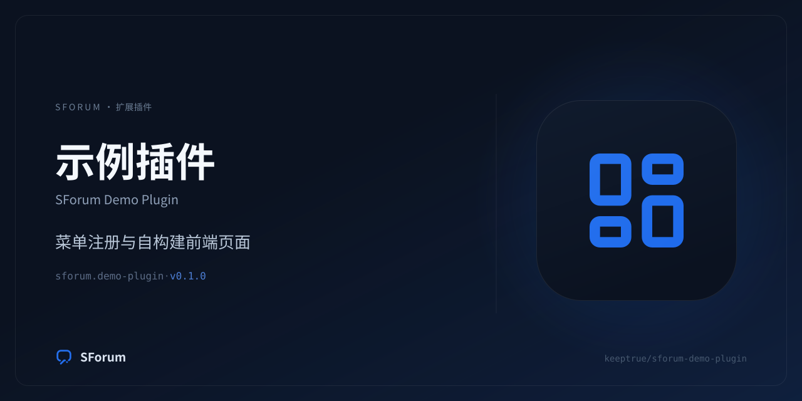

# SForum Demo Plugin

[](https://github.com/keeptrue/sforum-demo-plugin/actions/workflows/ci.yml)
[](https://github.com/keeptrue/sforum-demo-plugin/releases)



演示 SForum 插件的两件事：**管理端菜单注册**，以及**作者自构建的前端页面**。
启用后后台侧栏多出一个由清单声明的「示例」一级菜单，展开是两个页签；其中「示例面板」的主体是
一段作者用 Vue + Vite 预先构建好的 ESM 模块。
侧栏、顶栏、页签、路由守卫、页面标题与权限全部由宿主渲染，插件不写路由、不带后端进程。

- 形态：SForum 扩展包（Manifest V3，`type: plugin`），只有前端制品。
- 前端：`@sforum/plugin-ui` + `@sforum/admin-sdk`，Vite 构建成 `frontend/admin/dist/dashboard.mjs` 与 `dashboard.css`。
- 权限：`sforum.demo-plugin.manage`，由插件声明、宿主授权，推荐映射给 `administrator` 角色。

## 演示了什么

### 1. 菜单注册

插件的管理页完全由 `sforum.extension.json` 的 `admin.pages[]` 描述，示例声明了两个页签：

| 字段 | 示例取值 | 作用 |
| --- | --- | --- |
| `path` | `/demo`、`/demo/settings` | 宿主命名空间下的页签路径，实际路由为 `/control-panel/extensions/{id}/pages{path}` |
| `view` | `component`、`settings` | `component` 挂载自构建模块；`settings` 交给宿主渲染本包 Settings Document |
| `menu` | `true`、`true` | 把该页签放进后台侧栏；未声明的页签只能从入口链接进入 |
| `group` | `示例`、`示例` | 同扩展内同名的页签合成一个一级菜单；命中 Core 分区时并入该分区 |
| `order` | `10`、`20` | 同级页签的排序权重，数字小的在前 |
| `permission` | `sforum.demo-plugin.manage`（`/demo/settings` 未声明） | 侧栏项与页签的权限门；无权限的用户看不到、也进不去 |
| `icon` | `i-lucide-sparkles`、`i-lucide-sliders-horizontal` | 侧栏图标，取自宿主图标集 |

宿主侧负责的是「这些声明怎么变成界面」：侧栏项、图标解析、权限过滤、路由注册、面包屑与页面标题
都由宿主产出。插件只声明「我有这些管理页」，不注册路由，也不渲染导航。

`group: "示例"` 是本示例真正用到的机制：两个页签被收进一个**可展开的一级菜单「示例」**，
位置插在「扩展管理」之后、与内置分组同级；同一扩展里 `group` 相同的页签归为同一个分组。
如果 `group` 恰好命中 Core 已注册的分区（目前只有 `ai-tools`），页签会并入那个分区的一级菜单，
而不是自成一组。只有**未声明** `group` 的页签才平铺在「扩展管理」内，且仅专业模式可见。
因此后台实际入口是 `/control-panel/extensions/sforum.demo-plugin/pages/demo` 与
`…/pages/demo/settings`，而不是平铺的扩展页。

### 2. 自构建前端页面

页面源码是标准 Vue 单文件组件，构建产物是宿主可直接加载的微前端模块：

```text
frontend/admin/src/AdminDashboard.vue   ← 页面主体（SPlugin* 组件）
frontend/admin/src/admin.ts             ← definePluginPage(组件, apiVersion) → { apiVersion, mount }
        │  vite build（@vitejs/plugin-vue）
        ▼
frontend/admin/dist/dashboard.mjs       ← export const apiVersion = 1; export function mount(target, bridge)
frontend/admin/dist/dashboard.css
```

`frontend/admin/package.json` 的依赖分两层：

- 运行时与打包：`vue`、`@sforum/plugin-ui`、`@sforum/admin-sdk`（Vue 与组件库会被打进产物，宿主不装依赖）；
- 开发期：`vite`、`@vitejs/plugin-vue`、`typescript`。

脚本只有 `build`（`vite build`）。构建由 `sforum extension build` 驱动：装依赖 → `bun run build` →
刷新 `packageFiles` 摘要 → 校验清单 → 跑宿主契约检查。CI 每次推送都跑同一条命令，
所以 `dist/` 里的摘要与源码始终同步。`extension build` 只跑 `vite build`，本示例不额外配置类型检查步骤。

生产宿主**不编译 Vue**：运行时只读取清单 `packageFiles` 里登记的
`frontend/admin/dist/*.mjs|*.css`，`src/` 与 `vite.config.ts` 不参与加载，插件也拿不到
Nuxt 构建链。因此改完页面必须重新构建并提交 `dist/`，否则 exact-artifact 摘要对不上，启用会被拒绝。

## 目录结构

```text
sforum-demo-plugin/                     ← 仓库根 = SForum 外部扩展源根
├── plugins/sforum-demo-plugin/         ← 扩展包本体
│   ├── sforum.extension.json           ← 清单：admin.pages[]、权限、设置、packageFiles 摘要
│   ├── README.md                       ← 包级说明：菜单声明与构建命令
│   ├── brand/                          ← 品牌资产（icon.svg / icon.png / social-preview.png）
│   └── frontend/admin/
│       ├── package.json                ← 作者侧依赖与 build 脚本
│       ├── tsconfig.json
│       ├── vite.config.ts              ← 入口 src/admin.ts，输出 dist/dashboard.mjs + dashboard.css
│       ├── src/
│       │   ├── AdminDashboard.vue      ← 页面主体
│       │   └── admin.ts                ← 微前端入口
│       └── dist/                       ← 构建产物（唯一被宿主加载的部分）
│           ├── dashboard.mjs
│           └── dashboard.css
├── .github/workflows/                  ← ci.yml / release.yml
├── scripts/prepare-package.sh          ← 构建 + 校验 +（可选）打 zip 的一键脚本
└── LICENSE
```

## 安装

1. 从 [Releases](https://github.com/keeptrue/sforum-demo-plugin/releases) 下载 `sforum-demo-plugin_<version>.zip`，
   需要校验时对照同页的 `SHA256SUMS`。
2. 装到 SForum（两种方式任选）：
   - **上传**：后台「插件管理 → 安装插件」选择 zip；
   - **外部源**：解压到某个外部源根的 `plugins/sforum-demo-plugin/`，然后重启 API
     （本仓库根就是源根，可直接把仓库路径加进 `EXTERNAL_EXTENSION_ROOTS`）。
3. 后台启用 **SForum Demo Plugin**，按宿主提示完成一次 exact-artifact `super_admin` 信任确认
   （`授权当前精确制品` → `确认并启用`）。
4. 需要看到侧栏入口的角色，到「角色权限」确认已具备 `sforum.demo-plugin.manage`。

包内容变化会生成新的候选制品，需要重新确认信任；**版本号不变只改内容时**用「禁用 → 升级 → 启用」
切换制品（单纯重启不会切换）。

## 本地开发

四样前置：

- SForum 检出：提供宿主 CLI 与校验规则；
- Go 工具链：CLI 本身是 Go 程序，用 `go run` 启动；
- Bun：构建 `frontend/admin`；
- python3：`scripts/prepare-package.sh` 用它读清单版本号并拼发布资产名。

本仓库与 SForum 检出同级放置即可：

```text
Code/github/
├── SForum                     ← 框架检出
└── sforum-demo-plugin         ← 本仓库
```

所有命令都从 SForum 的 `apps/api` 目录执行，包路径指向本仓库的扩展包：

```bash
cd SForum/apps/api

# 装依赖 + 构建 dist + 刷新 packageFiles 摘要 + 校验 + 契约测试（一条命令走完）
go run ./cmd/sforum extension build ../../../sforum-demo-plugin/plugins/sforum-demo-plugin

# 只校验清单与包结构
go run ./cmd/sforum extension validate ../../../sforum-demo-plugin/plugins/sforum-demo-plugin

# 只跑宿主契约检查（能力、事件、贡献点、入口）
go run ./cmd/sforum extension test ../../../sforum-demo-plugin/plugins/sforum-demo-plugin

# 校验品牌资产尺寸与字节上限
go run ./cmd/sforum extension brand check ../../../sforum-demo-plugin/plugins/sforum-demo-plugin
```

依赖已装好时可以给 `extension build` 加 `--skip-install` 跳过安装。
改了 `src/` 之后必须重跑 `extension build`：`packageFiles` 摘要按文件内容计算，
`dist/` 不刷新就会与清单不一致。若 SForum 已把本仓库挂成外部源，重启 API 后会把它暂存为候选制品，
按「禁用 → 升级 → 启用」切过去即可。

`scripts/prepare-package.sh` 把上面四步串成一条命令（`SFORUM_DIR` 可覆盖宿主检出位置，
加 `--package` 会额外在 `dist/` 下打发布 zip 与 `SHA256SUMS`），CI 用的就是同一套门禁。

## 发布

推 `v*` 标签即触发 [release 工作流](.github/workflows/release.yml)：

1. `verify`：校验标签与清单 `version` 一致，再跑 `extension build`、`brand check`、`validate`、`test`。
2. `package`：重新构建一次保证 zip 与清单摘要同源，用 `extension package --exclude-source` 打成
   `sforum-demo-plugin_<version>.zip`（纯前端制品，一份包全平台通用），连同 `.zip.sbom.json`
   生成 `SHA256SUMS`。
3. `publish`：先 `sha256sum -c SHA256SUMS` 复核，再创建（或更新）Release 并上传资产。

发布前把 `plugins/sforum-demo-plugin/sforum.extension.json` 的 `version` 提到与标签一致
（例如 `0.1.0` ↔ `v0.1.0`），否则 `verify` 直接失败。日常推送与 PR 由
[ci 工作流](.github/workflows/ci.yml) 跑同一套构建与校验，并额外检查
「提交的 `dist/` 是否等于当前源码的构建结果」——制品漂移会直接失败，所以构建产物必须跟源码一起提交。
release 的 `verify` 也带同样的漂移检查：标签构建如果改写了已提交的制品，发布会在打包前失败。

## 技术要点

- **Admin Micro-frontend API v1**：入口导出 `apiVersion = 1` 与 `mount(target, bridge)`，
  宿主把组件挂进页面 body；`bridge` 提供 `page`、命名空间化的 `request`、`toast`、`t`、`navigate`、
  locale 与外观，宿主始终持有布局与权限。
- **`@sforum/plugin-ui`**：`SPluginPage`、`SPluginSection`、`SPluginTable`、`SPluginButton` 等组件
  读取宿主稳定的外观变量并自带兜底，暗色由宿主切换，插件不必自带设计系统、通常也不用写 CSS。
- **宿主图标**：`i-lucide-*` 由宿主图标解析器下发（`/_sforum/icons`），插件不打包图标集、
  不自绘 SVG；名称不在宿主语法内或解析失败时降级为空占位并打一条控制台警告，不会抛错、也不阻塞挂载。
- **`packageFiles` 精确摘要**：`dist/dashboard.mjs` 与 `dashboard.css` 的 sha256 写在清单里，
  宿主按摘要校验后加载；摘要不匹配即拒绝启用，所以产物必须与源码一起提交。
- **无后端**：没有 `backend` 字段、没有路由、没有数据库租约，插件只在管理端出现，
  不参与前台请求链路。

## 许可

MIT。
